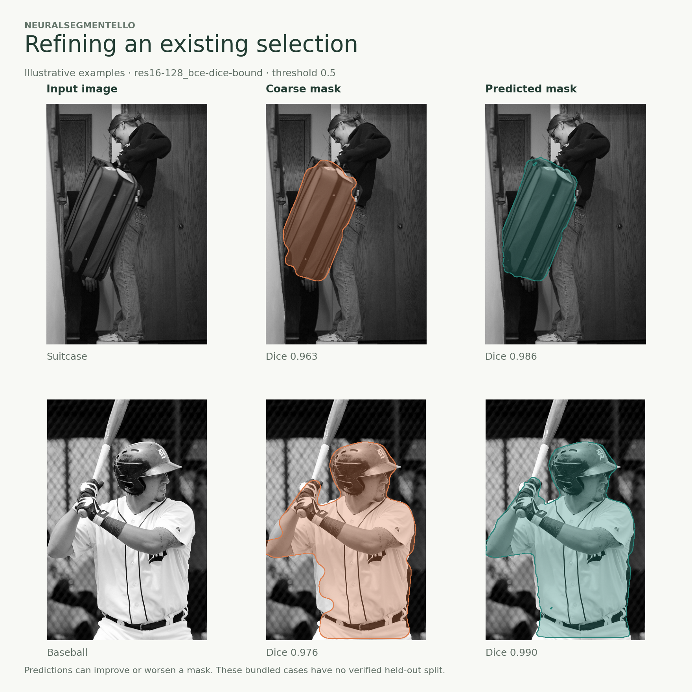

# NeuralSegmentello

Refine a rough object mask with a compact U-Net. Give the model an image and a coarse foreground selection; get back a binary mask at the original image size.

[Project report](docs/NeuralSegmentello.pdf) · [Evaluation notes](docs/EVALUATION.md)



The smallest model has **117,681 parameters** and runs on CPU. This repository includes eight trained checkpoints, a brush-based browser demo, a Python API, and tools to evaluate or retrain the models. It is a research project: refinement can improve a boundary or remove useful parts of a selection, depending on the image and the coarse mask.

## Quick start

Python **3.12 or 3.13**. Clone the repository to get the checkpoints and examples:

```sh
git clone https://github.com/andrea-gentilini/NeuralSegmentello.git
cd NeuralSegmentello
python -m venv .venv
source .venv/bin/activate        # Windows: .venv\Scripts\activate
python -m pip install -e ".[demo]"
segmentello-demo
```

Open **http://127.0.0.1:7860**. Choose an example, paint a rough filled-in selection, or upload an image and its mask. Refine it, compare the overlays, and download the PNG. The local demo processes images on your computer. [Hugging Face deployment instructions](deploy/huggingface/README.md) are included for hosting your own instance.

The demo runs on CPU and limits the working image to 640 pixels on the longer edge, restoring the result to the original size. The first request loads the selected checkpoint. CLI and Python inference also support CUDA and Apple MPS when available. CPU execution is covered by the automated tests.

With [uv](https://docs.astral.sh/uv/), use `uv sync --extra demo` and `uv run segmentello-demo` instead. No dataset download is needed to try the project. Stop the local server with Ctrl+C.

## Refine from the command line

```sh
segmentello predict \
  --image examples/demo/photo-1.png \
  --mask examples/demo/photo-1-mask.png \
  --model res16-128_bce-dice-bound \
  --device cpu \
  --output outputs/refined-mask.png \
  --probability-output outputs/probability.npy \
  --metadata-output outputs/prediction.json
```

Masks must have the same dimensions as the image, with foreground encoded as **1 or 255** and background as **0**. The output PNG uses 0/255. Use `--max-side 640` to limit memory use; without it, inference uses the original resolution. `--threshold` applies to foreground probability and defaults to 0.5.

```sh
segmentello info
segmentello info --model res16-32_bce-dice
```

Models are loaded from the cloned `models/` directory. Use `--models-dir` for another model directory, or `--checkpoint` for a checkpoint matching the selected architecture. Loading is strict and uses PyTorch's restricted weights-only loader. The Python wheel contains code; model weights and example data remain in this repository.

## Python API

```python
from PIL import Image
from segmentello.inference import Refiner

refiner = Refiner("res16-128_bce-dice-bound", device="cpu")
result = refiner.predict(
    Image.open("examples/demo/photo-1.png"),
    Image.open("examples/demo/photo-1-mask.png"),
)
Image.fromarray(result.mask * 255).save("refined-mask.png")

# result.probability: float32 H×W foreground probabilities
# result.mask: uint8 H×W binary mask
# result.metadata: settings, dimensions, and checkpoint fingerprint
```

Reuse a `Refiner` across images to avoid reloading the checkpoint. RGB images are accepted and converted to the training representation: **coarse mask, grayscale image, normalized Sobel magnitude**. Images are padded to fit the network, then cropped back to their original dimensions.

## Models

| Family | Channels | Parameters | Training losses available |
| --- | --- | ---: | --- |
| Tiny U-Net | 16–32 | 117,681 | BCE + Dice |
| Residual U-Net | 16–32 | 117,681 | BCE + Dice |
| Tiny U-Net | 16–32–64–128 | 1,944,049 | BCE + Dice; BCE + Dice + boundary |
| Residual U-Net | 16–32–64–128 | 1,944,049 | BCE + Dice; BCE + Dice + boundary |
| Residual U-Net | 32–64–128–256 | 7,765,985 | BCE + Dice + boundary |
| Attention U-Net | 32–64–128–256 | 7,854,717 | BCE + Dice + boundary |

All eight bundled checkpoints load and pass an inference smoke test. Their tensor fingerprints are distinct; see the [checkpoint inventory](docs/models.json). The default is `res16-128_bce-dice-bound` (1.94M parameters), a residual model trained with a boundary loss. The 117K-parameter models remain available for smaller workloads. Architecture and loss labels follow the original checkpoint folders.

## Evaluate

The benchmark compares **the coarse input and the refined output against the same target**. It reports Dice, IoU, boundary F1, per-image changes, and latency, together with input hashes and checkpoint fingerprints.

```sh
python -m segmentello.benchmark \
  --dataset bundled \
  --models res16-128_bce-dice-bound \
  --device cpu \
  --output outputs/benchmark \
  --save-predictions
```

To evaluate the 49 annotated images from the 50-image COCO subset, use `--dataset coco` (one image has no annotations). This generates coarse masks deterministically with seed 42. Use `--models` followed by several names to compare models on identical inputs. JSON and CSV retain both gains and regressions.

**These are demonstration benchmarks, not held-out test results.** The images come from COCO train2014 or the original illustrative examples, and the training membership of the supplied checkpoints is not recorded. The [evaluation notes](docs/EVALUATION.md) include the measured results, full protocol, limitations, and differences from the 2025 report.

## Train

A small COCO subset is included so the training path can be exercised without downloading the full dataset:

```sh
python -m segmentello.training \
  --dataset dataset/COCO_dset_adaptation/reduced_dset \
  --output outputs/training-smoke \
  --model res16-32_bce-dice \
  --accelerator cpu \
  --workers 0 \
  --fast-dev-run
```

Remove `--fast-dev-run` for a training run, set `--epochs`, and choose a fresh output directory (for example, `--output outputs/training-run-1`). Nonempty output directories are rejected to preserve each run’s checkpoints and split manifest. Training and validation are split by source image; validation corruptions are fixed by seed and image ID. Each run saves its split so the samples can be checked. The included 50-image subset is for development, not enough to establish model quality. See `python -m segmentello.training --help` for model and training options.

The original project used 1,000 COCO images, with a 900/100 training/validation split. That full prepared subset and its original split manifest are not included. The report describes the historical experiment; running the development subset does not reproduce it.

## Development

```sh
python -m pip install -e ".[dev,demo]"
pytest -q
ruff check src tests examples deploy
python -m build
```

Tests cover checkpoint loading, input validation, image-size preservation, metric edge cases, dataset identity, deterministic splits and corruptions, and demo input handling. GitHub Actions runs the CPU suite, lint, and package build.

## Authors and sources

[Andrea Gentilini](https://github.com/andrea-gentilini), [Michele Magrini](https://github.com/mich1803), [Leo Vincenzo Petrarca](https://github.com/leopetra20), and [Iacopo Scandale](https://github.com/IacopoScandale).

Built as a university project in 2025. The [report](docs/NeuralSegmentello.pdf) and [presentation](docs/Presentation.pdf) preserve the original work. Code is released under the [MIT license](LICENSE). COCO images and annotations retain their original terms; see [COCO's dataset information](https://cocodataset.org/#termsofuse). Bundled illustrations are example inputs, not newly licensed assets.
